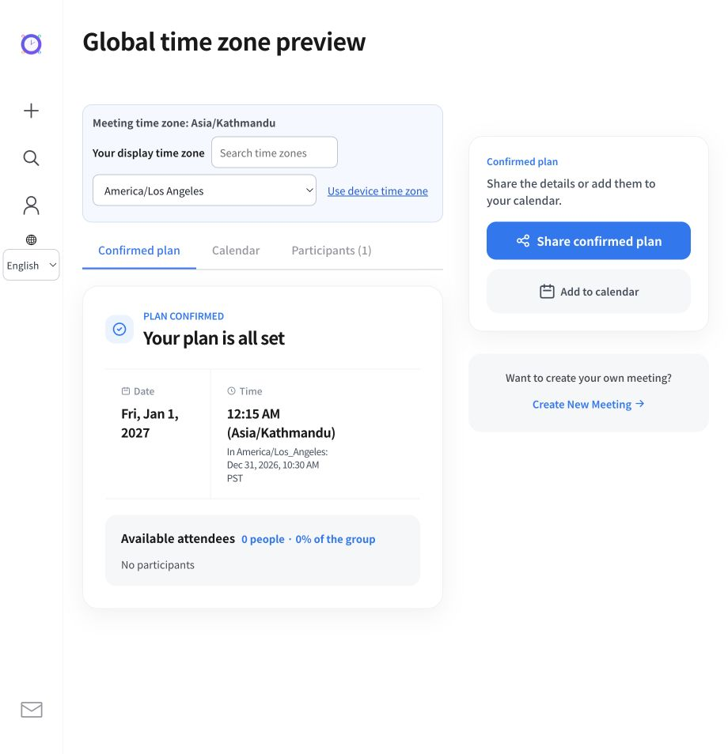
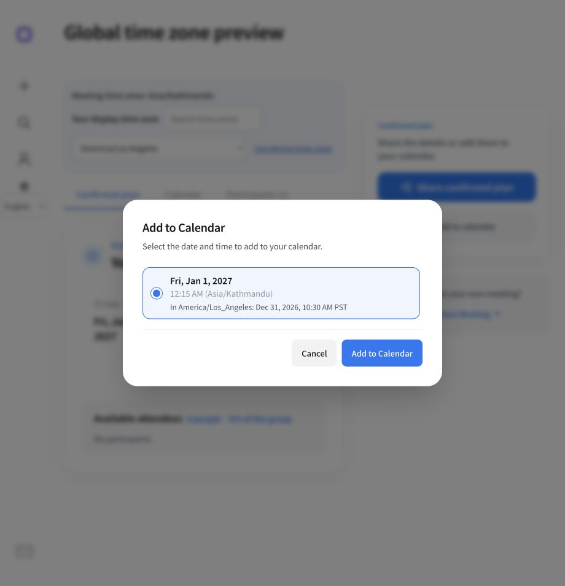
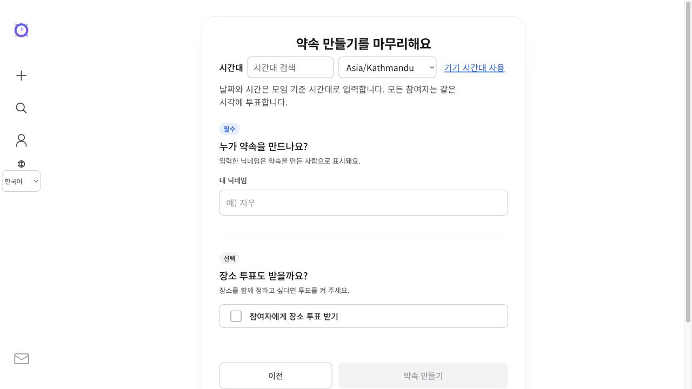

# Global language and time zone support

Implemented 2026-10-25. This document describes source changes, not a production deployment.

## Languages

The application, marketing pages, navigation and API errors share 22 language/region options: English, Simplified Chinese, Hindi, Spanish, Arabic, French, Bengali, Portuguese, Russian, Indonesian, Urdu, German, Japanese, Nigerian Pidgin, Arabic (Egypt), Marathi, Vietnamese, Telugu, Hausa, Turkish, Korean and Thai.

Scope is based on the 2025 Ethnologue total-speaker (L1 + L2) top 20, while retaining all existing languages. Egyptian Arabic is a separate entry in that ranking; `ar-EG` currently uses standard written Arabic UI text with Egyptian regional formatting. This is not a claim of a complete colloquial Egyptian translation. `pcm` has a dedicated Pidgin catalog; `Intl` formatting uses `en-NG` because browser CLDR support for Pidgin is limited.

Sources checked on 2026-10-25 KST:

- [Ethnologue ranking methodology](https://www.ethnologue.com/insights/ethnologue200/). Direct access was blocked during research; its methodology was checked through a mirror.
- [2025 ranking reproduction](https://www.jetpunk.com/user-quizzes/2026529/top-200-languages-ethnologue-2025). The 2026 ordering could not be verified, so the selection does not claim to be a verified 2026 ranking.
- [W3C language negotiation](https://www.w3.org/International/questions/qa-site-conneg.en.html).
- [Google Calendar time zone behavior](https://support.google.com/calendar/answer/37064?hl=en-au).

The locale registry is `src/i18n/config.ts`. Additions require an app JSON catalog, marketing copy, and matching backend `LocaleConfig`/message bundles. Generic entry paths negotiate the explicit `lang` query, saved cookie, and weighted `Accept-Language`, in that order. Unsupported languages fall back to English. Language switching updates the query so a previous query cannot override a new choice. HTML `lang` and `dir`, date/month/weekday/time formats and calendar week starts follow the selected locale. Shared links omit the sender's `lang` preference so recipients can use their own language.

Country is not inferred from language or IP. Display language and IANA time zone are independent preferences. Browser time zone is a default suggestion, not evidence of nationality or residence.

## Translation provenance and quality

New app catalogs were bootstrapped with machine translation of generic English UI strings, then checked for complete coverage, nonempty values, interpolation tokens, brand preservation, English fallback leakage, and selected primary-flow terminology. Existing marketing translations were retained; new marketing languages were translated from the complete English copy. Pidgin uses a curated phrase glossary plus explicit core-flow and marketing translations. Arabic and Russian participant/vote forms have additional plural categories. English singular/plural handling is covered by tests.

All translations ship as local static resources. The server injects only the selected catalog into the app document; other language catalogs are excluded from the browser bundle. Marketing pages do not load app catalogs. There is no translation API call or third-party translation dependency at runtime, and meeting titles, participant names and other user content are not sent to a translation service.

These are initial translations, not certified or native-speaker-reviewed copy. Automated validation establishes technical completeness, not idiomatic quality. In particular, new marketing/legal translations and Pidgin terminology should receive native review as product traffic is observed. Do not represent this as professional linguistic or legal translation.

## Time semantics

- A new meeting suggests the device's IANA time zone. The host can search and change it before entering times or finishing creation. The draft zone survives wizard navigation and reloads in the same tab.
- Existing meetings are not migrated or reinterpreted. API callers omitting `timezone` retain the legacy `Asia/Seoul` default; the web app explicitly sends the selected device/host zone.
- Stored date and slot keys remain wall times in the meeting's zone. A participant's display zone is independent and can be changed without altering voting keys.
- Voting columns and the time axis remain in the meeting zone. Each cell also shows the participant's local date and time when zones differ. Results, confirmation, calendar dialogs and shares identify the meeting zone. Local result labels include the year so previous/next-year rollover is clear.
- Date-only votes keep their calendar dates in every zone. They are not treated as midnight instants.
- Conversion uses rules for the actual meeting date, including DST and fractional offsets. Nonexistent spring-forward times and ambiguous fall-back times are rejected by frontend creation validation and backend creation, date updates and confirmation. The current slot model cannot distinguish the two occurrences of a repeated wall time; the UI does not silently pick one.
- Timed ICS exports contain UTC `DTSTART`/`DTEND` instants, including elapsed duration across transitions. Date-only ICS exports retain RFC 5545 `VALUE=DATE` values.

## Validation

- `npm run check:i18n`: app key coverage, nonempty text, placeholder parity and marketing availability for all 22 options.
- `npm run test:globalization`: weighted negotiation and preferences, all language formatters, plural forms, week starts, 12/24-hour round trips, invalid dates, quarter-hour offsets, cross-year conversion and DST gaps/overlaps including Lord Howe's 30-minute transition.
- `npm run build` and TypeScript checking.
- Targeted ESLint checks on changed TypeScript/React files. The repository-wide lint command also scans generated `.astro`/`dist` outputs and has pre-existing findings; generated code was not reformatted.
- Backend `./gradlew test`: 126 tests passed, including locale resources, seasonal offsets, invalid/ambiguous times, backwards-compatible defaults and ICS behavior.
- Browser checks: Japanese language changes persist between creation steps; Arabic RTL mobile layout; Nepal-to-Los Angeles conversion across New Year; identical conversion in the calendar dialog; local-time voting preserves the original canonical slot key.

The screenshots below use a disposable local fixture with the real result/calendar components. The fixture route was removed after testing. No production meeting was created.

