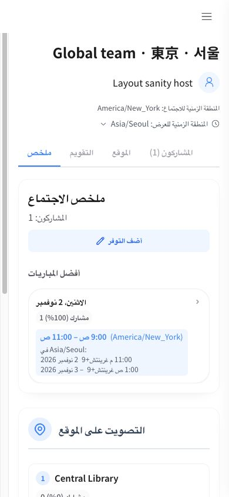
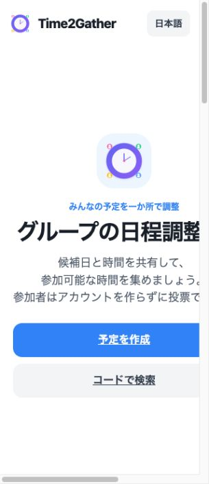
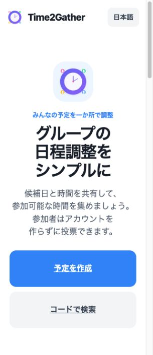
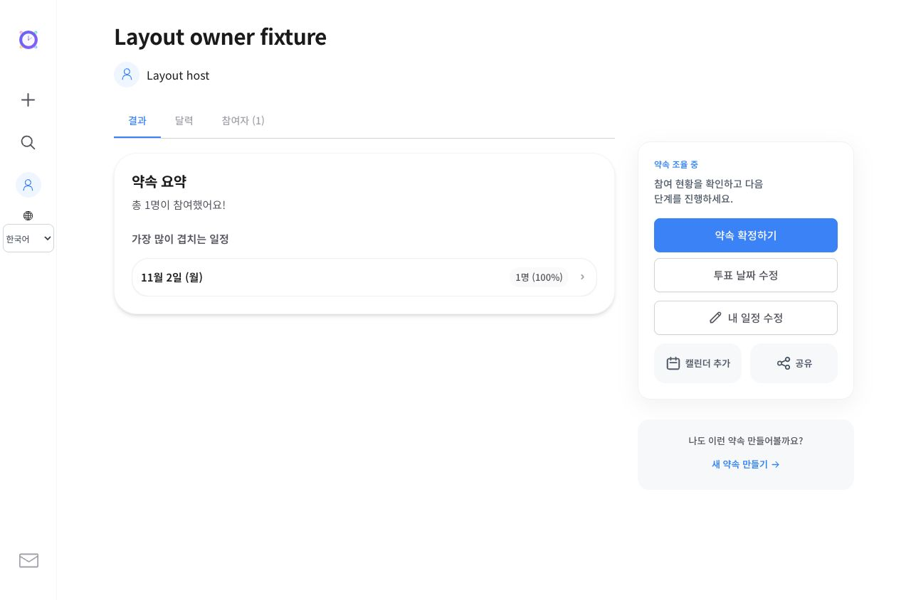
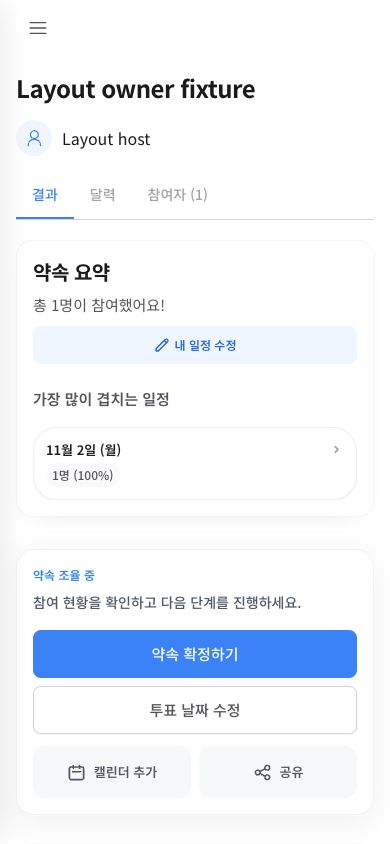

# Multilingual line wrapping and mobile layout — 2026-10-25

## Findings and changes

- The shared `word-break: keep-all` policy was applied to every language. On a 320px viewport, the Japanese marketing title and description exceeded the visible page, and Chinese marketing content also overflowed. Shared typography now uses Korean eojeol preservation only for Korean, native browser word/dictionary boundaries for other scripts, strict CJK punctuation, and progressive `auto-phrase` support for Japanese/Chinese. Short headings are balanced; body text uses pretty wrapping where supported. Long technical/user tokens retain an overflow escape hatch.
- Marketing grid children could retain oversized minimum widths. Children now shrink within their column; mobile heading/description widths are capped by their actual parent. CTAs can grow vertically. Joining and Indic scripts use normal heading letter spacing; their mobile hero titles use a smaller size and roomier line height.
- Native time labels were squeezed into very narrow flex space on desktop. Labels now have their own column and inputs can shrink; mobile keeps the stacked arrangement.
- Translated Today labels in 7-column calendars crossed their cells (French, Russian and Vietnamese were reproduced). Compact calendars now use a dot while preserving `aria-current=date` and a full localized tooltip. Month grids use zero-minimum fractional tracks. Time-grid date headers use consistent 100px columns and wrap localized date labels instead of overflowing.
- With actual votes, result time badges inherited `nowrap`, clipping the original and converted times in all 22 locales. Badges now fit their cards, and displayed date/time/zone pieces have explicit semantic wrapping boundaries. Clock/day-period strings and localized dates stay intact. Year, offset and next-day information are retained. Date/time conversion regressions cover a New York → Seoul midnight boundary.
- Narrow summary headers now stack their title and action, avoiding crushed headings and stranded participant counts. Calendar/confirmation choices put participant counts below schedule details on narrow screens. Dialog buttons grow to fit translated labels, and narrow confirmation progress uses a vertical layout.
- Candidate-date headings in many catalogs incorrectly referred to job applicants/candidates. Nineteen headings were replaced with concise date-selection wording; already natural Korean, Japanese and Pidgin wording was retained.
- A locale missing from the browser's date formatter data (Hausa was reproduced) previously inherited the device language and displayed Korean dates. It now uses an explicit English fallback while preserving the selected UI catalog.

## Validation

- Final browser matrix: 22 locales × 18 pages/states × 2 viewports = 792 checks, plus 22 locales × 2 dialogs × 2 viewports = 88 checks; **880 final combinations**.
- Viewports: 320×740 and 390×844. States: localized marketing home/about/contact/privacy/terms; five creation steps; search; authenticated personal lists; 404; TIME/ALL_DAY results with a real local vote; TIME/ALL_DAY voting; administrator login; confirmation and calendar export dialogs.
- Final checks found no unintended horizontal text overflow, page overflow or text hidden by fixed-height clipping in the inspected states. Intentionally scrolling tabs/time grids, hidden closed-disclosure contents and the existing four-pixel calendar count-badge overhang are excluded from those checks.
- Representative Japanese, Telugu, English, Korean and Arabic screens were visually reviewed. The desktop Korean time-label regression was also visually checked. DOM geometry checks supplement visual review; they do not establish native-language editorial approval of every possible sentence or identical line positions across every browser/font.
- Catalog validation: 462 messages across 22 locales. Globalization, autocomplete, semantic date/time boundary and unsupported-Intl-locale regressions passed. TypeScript no-emit, focused changed-TypeScript ESLint, production build and `git diff --check` passed. Existing unrelated Astro layout lint findings remain outside the focused lint scope.
- Test writes used a separate in-memory H2 server. No production meeting or user was created.

## Typography references

Official documentation checked on 2026-10-25 KST:

- [W3C CSS Text — language-specific line breaking](https://www.w3.org/TR/css-text-4/)
- [W3C Internationalization — approaches to line breaking](https://www.w3.org/International/articles/typography/linebreak.en.html)
- [MDN — word-break](https://developer.mozilla.org/en-US/docs/Web/CSS/Reference/Properties/word-break)
- [MDN — overflow-wrap](https://developer.mozilla.org/en-US/docs/Web/CSS/Reference/Properties/overflow-wrap)

## Evidence

## Production release

Verified at 2026-10-25T16:44:56+09:00 on https://time2gather.org.

- Final Cloud Build `4b9c27a8-ade7-4abc-b28d-3123052c3c15` succeeded, image `web:multilingual-wrap-20261025-1633`.
- Web revision `time2gather-web-00064-xut` receives 100% of default traffic; Firebase Hosting release completed and pins the web rewrite to the released revision. Backend unchanged.
- Candidate and live HTTP checks passed all 22 selected-locale documents and early UTF-8 declarations. Ten directly referenced client assets, including component entries, matched the production build byte for byte.
- Live 320px Japanese, Chinese, Arabic and Telugu home pages passed the overflow/clipping checks. The Japanese language menu also passed when open. The live 390px French date-selection screen passed. No browser console errors or new-revision HTTP 5xx requests were observed at the final check.
- Local test servers were stopped and their H2 data discarded. Source changes remain uncommitted, and previous deployment revisions are retained.

## Follow-up: action readability on desktop and intermediate widths

The previous overflow/clipping matrix missed a readable-layout failure: a 304px desktop sidebar placed host actions in 3:2 columns. The edit-date link had only 100px total width, producing four lines in Korean and stretching the adjacent confirmation button to 107px. Absence of clipping was insufficient to establish acceptable line wrapping.

- Host actions now each occupy a full row regardless of viewport width. Korean now reads `투표 날짜 수정`; all 22 catalogs use a shorter edit-voting-dates action.
- Personal availability actions reuse the concise summary labels. The mobile hide rule now has sufficient specificity to override the shared Button display rule, removing the duplicate action below the summary.
- With one actual local vote and the browser authenticated as the host, checked all 22 locales at widths 320, 390, 430, 768, 1024 and 1280: 132 result states. Every visible action in the panel fits within two lines; no page overflow. Korean desktop host actions now each fit on one line at 48px height.
- Also checked the actual host date editor in 22 locales at four widths (88 states), and confirmation dialogs at 320/1280 (44 states): no page overflow or action buttons taller than 85px. Total follow-up matrix: 264 states. Korean desktop/mobile and Telugu desktop received visual review. Edit-date navigation, local vote submission and confirmation-dialog opening were exercised.
- Catalog/globalization regressions, TypeScript no-emit using the installed compiler, focused ResultButtons ESLint, production build and whitespace checks passed. These measurements supplement visual review; they do not certify native editorial quality for every translation.

Follow-up released on 2026-10-25 KST: Cloud Build `7d2ea8a4-9ab8-473d-b6e8-b9e3f7e6753e` succeeded; image `web:host-actions-wrap-20261025-1721`, revision `time2gather-web-00066-met` serves 100% traffic. Firebase Hosting release completed. The live result page and all 34 referenced dependency assets returned HTTP 200; the live action-panel CSS matches the tested CSS. Production browser confirmed the concise participation action and working calendar dialog without console errors; no new-revision 5xx requests were found. Backend unchanged, local test servers stopped.
