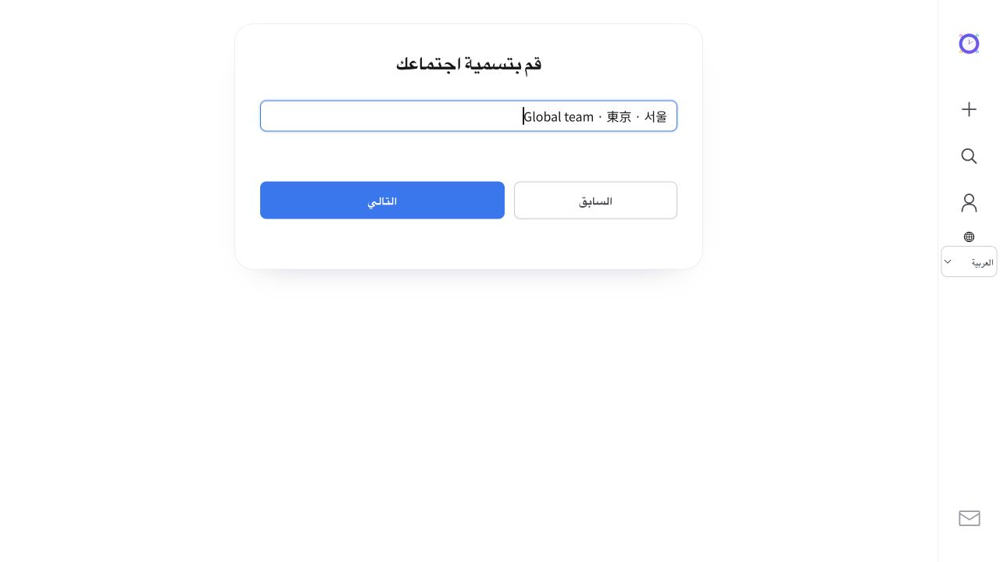
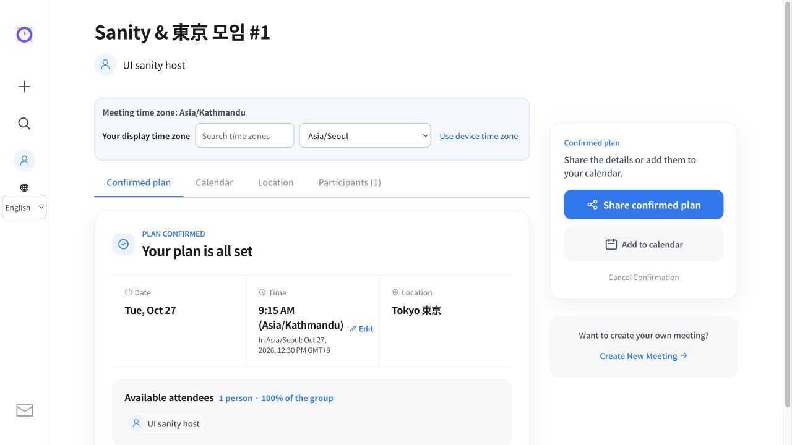
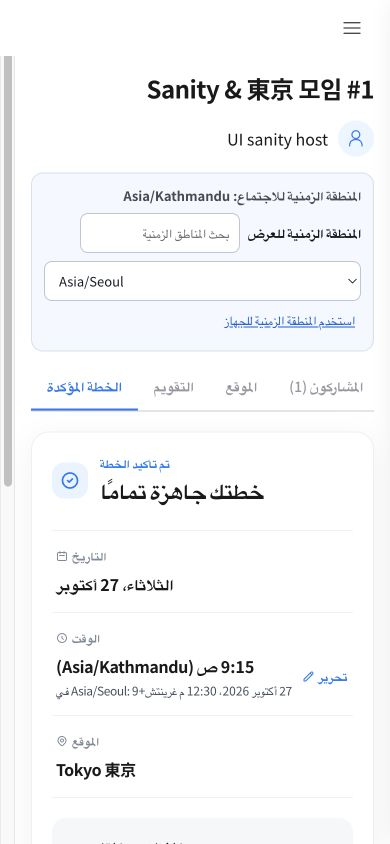

# 2026-10-25 globalization sanity and release

## Local validation

- Backend: all 126 Gradle tests passed with no failures or skips.
- Real HTTP API sanity: 55 requests passed using a separate H2 in-memory database. Reproducible with backend `node scripts/sanity-api.mjs` against a local server; the script refuses non-loopback destinations.
- API coverage: anonymous sessions, access control, TIME and ALL_DAY creation, Unicode/ampersand/hash titles, date/time and location voting, confirmation, exact-time edits, cancellation, date changes and discarded votes, personal meeting lists, UTC/date-only ICS export, midnight ranges, DST rejection, all 22 error locales and admin access rejection.
- Browser: actual creation, voting, location selection, confirmation, exact-time edit, matching calendar dialog, personal lists, native midnight input, mobile Arabic RTL and all 22 language switches.
- A local reverse proxy emulated Firebase Hosting by forwarding only `__session` cookies. Japanese navigation and a return to `/` retained the selected language under that constraint.
- Changed TypeScript passed type checking and focused ESLint; catalog validation (461 messages across 22 locales), globalization regressions and production build passed.

The external AI response was stubbed locally. Live Google administrator sign-in and native-speaker review of every translation were not part of these checks. No production users or meetings were created by the sanity script.

## Issues found and repaired

1. Switching language reloaded the page and discarded unsaved titles, nicknames, locations and votes. The selected catalog and metadata now update while React roots stay mounted. Static localized headings update too.
2. Firebase Hosting can filter non-session cookies, so a locale cookie alone did not preserve language across navigation. Internal links and programmatic navigation now carry `lang`; generic marketing entry points restore a saved client preference. Export/API/external links are excluded, and shared meeting links still allow recipients to choose their own language.
3. Native time fields did not consistently update controlled state from input events. Creation and exact-time editing now use `onInput`; browser verification confirmed `00:00` and `09:15` reached the saved state.
4. Exact-time edits could erase the displayed available-attendee count because the UI looked up votes at the edited minute. The API now exposes the original `confirmedSlotIndex`, and the UI uses that original voting slot. A real 09:15 edit retained its participant.
5. A contiguous candidate ending at midnight could attempt to format an out-of-range slot. End formatting wraps to 00:00, and local range conversion advances the end date when needed.
6. Ambiguous translation of “Save time” meant “save/avoid spending time” in some languages. The action now uses an explicit Save label in every catalog. Japanese meeting/confirmation terminology and English singular count wording were also corrected.

## Candidate verification

- Release image tag: `globalization-20261025-1238`.
- Backend Cloud Build: `667a00fa-eb94-4201-a29e-539e3b1b3e12`.
- Frontend Cloud Build: `85c23507-e632-4e84-adf7-99896232523f`.
- Candidate frontend: 22 selected-language documents passed. Ten referenced client assets matched the local Firebase Hosting files byte for byte. A real browser preserved a typed title through a language switch.
- Candidate backend: health, Firestore reads, 22 localized errors, authorization rejection and unchanged administrator configuration were verified before promotion.
- New revisions: API `time2gather-api-00015-pih`; web `time2gather-web-00056-rew`.
- Prior revisions retained for rollback: API `time2gather-api-00013-qen`; web `time2gather-web-00054-cib`.

## Production deployment and verification

- Completed on 2026-10-25 at approximately 12:48 KST at https://time2gather.org.
- API `time2gather-api-00015-pih` and web `time2gather-web-00056-rew` each receive 100% of default Cloud Run traffic. Firebase Hosting deployment completed and pinned its frontend rewrite to the released web revision.
- Actual custom-domain checks passed for all 22 app locale documents, all 22 marketing entry pages, all 22 localized API error responses and both unauthenticated access checks. The six client assets referenced by the tested production document matched local release files byte for byte; direct API health returned 200.
- A production browser switched Japanese to Arabic while retaining the Unicode title. Localized navigation and RTL rendering were correct, with no browser console errors observed. No meeting was submitted in production.
- New-revision request logs contained no HTTP 5xx responses at the post-deployment check (30-minute query window).
- Prior revisions remain available for rollback. The working tree remains uncommitted; deployment used Cloud Build source archives.

## Evidence

