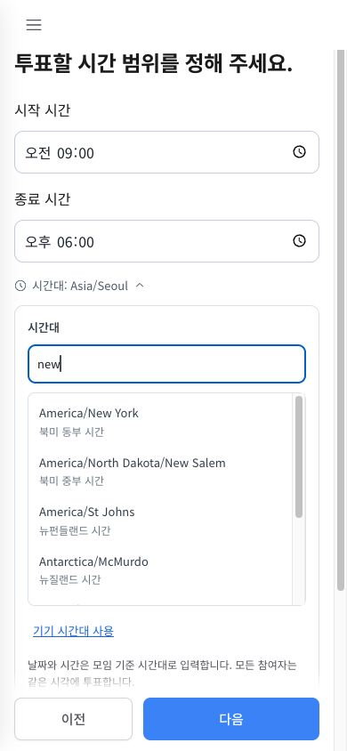

# Time zone autocomplete — 2026-10-25

The prior search field only filtered a native select. Matches stayed hidden until users opened a separate dropdown, and the selected zone was retained even when it did not match the query.

The existing compact disclosure now contains a live combobox and a visible, scrollable list of candidates directly below the input. Typing filters immediately without network requests. Candidates show their IANA identifier and Intl-localized zone name. Search normalizes case, accents, spaces, slashes and underscores; it includes English zone names and common Korean city aliases. These aliases supplement Intl names; they are not a complete worldwide translated-city database. Direct city/region identifier matches rank before incidental descriptive matches.

Mouse/touch selects a candidate. Arrow keys navigate candidates, Enter selects the active candidate (or a unique match), Escape closes the disclosure, and focus returns to the compact summary after selection. IME composition is excluded from keyboard selection handling. Unmatched text never changes the stored time zone. Empty states are translated in all 22 catalogs. The current selection is indicated with a check mark.

## Local validation

- Catalog validation: 462 messages across 22 locales, with matching keys/placeholders.
- Globalization regressions and new autocomplete cases passed: English/Korean search, region/city IDs, underscore normalization, accent-insensitive matching, empty query, no results and region ranking.
- TypeScript no-emit check, focused ESLint and production build passed.
- Browser: live New York list; Enter selection; Korean 서울 match and click; no-result Enter preserving the selection; ArrowDown twice selecting the second European candidate; Escape; focus restoration.
- At 390px mobile width the candidates remained visible without horizontal overflow and a tap selected/collapsed the control.
- Switched all 22 locales while an empty result was visible: each displayed a translated message; searching Tokyo afterwards immediately displayed its candidate.

## Production release

Verified at 2026-10-25T13:41:35+09:00 on https://time2gather.org.

- Cloud Build `a8783862-4c60-4319-955d-711e0a7d89c7` succeeded; image `web:timezone-autocomplete-20261025-1339`.
- Web revision `time2gather-web-00062-gij` receives 100% of default traffic; Firebase Hosting release completed and pins the frontend rewrite to this revision. Backend unchanged.
- Candidate and production HTTP checks passed 22 locale documents and early UTF-8 declarations. Ten referenced assets, including React component entries, matched the local release byte for byte.
- Production browser passed live New York results, ArrowDown/Enter selection and collapse, Korean 서울 search and click selection, and visible mobile candidates with no horizontal overflow. Empty-result messages were checked in all 22 locales on production.
- No browser console errors or new-revision HTTP 5xx request logs were observed at the final check. No production meeting or user was created. Source changes remain uncommitted, and older revisions remain available.

