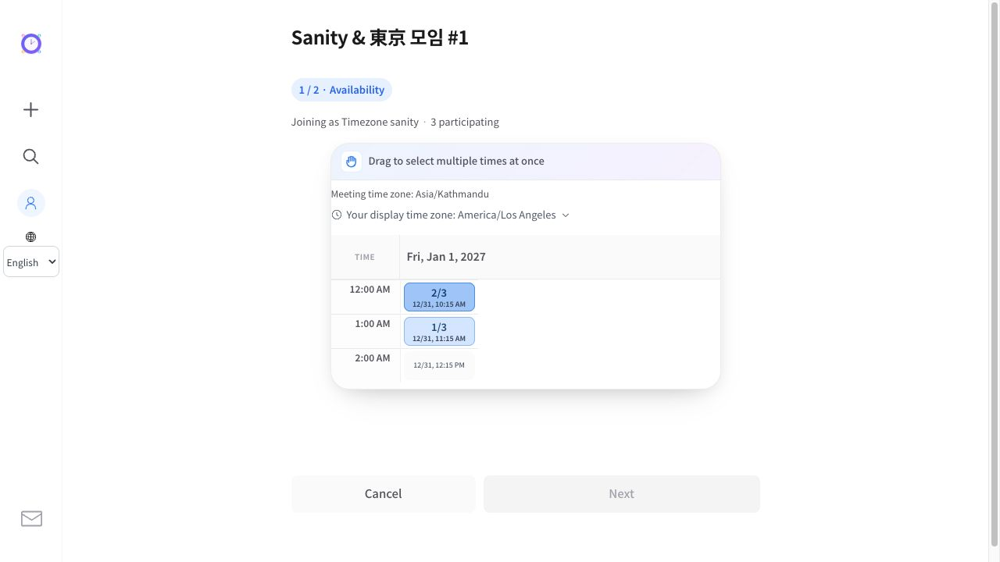
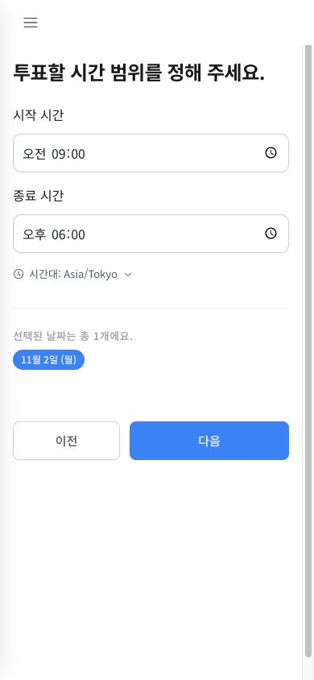

# Compact time zone controls — 2026-10-25

## Reference patterns

Official service documentation checked on 2026-10-25 KST:

- [Google Calendar: use different time zones](https://support.google.com/calendar/answer/37064?hl=en-au): local defaults, calendar-level preferences, and an event-level time zone control when editing an event.
- [Doodle: how time zones are managed](https://help.doodle.com/en/articles/9457362-how-does-doodle-manage-time-zones): automatic browser/account defaults, optional manual selection, and participant-local time display.
- [Calendly: book in a different time zone](https://community.calendly.com/how-do-i-40/calendly-book-different-timezone-1099): automatic invitee-local availability and an optional scheduling-page dropdown. This source does not establish an exact visual location for that dropdown.

Design inference: preserve automatic defaults, make the active zone readable near the relevant time controls, and disclose search/override options only when requested. This change adopts that disclosure pattern. The voting grid retains its meeting-zone date/time axis and existing secondary local-time conversion; it does not silently reinterpret existing votes in another zone.

## Implementation

- A 36px-high clock/label/zone/chevron summary replaces the always-visible search, select, reset button, and explanatory paragraph.
- Creation puts the summary below start/end inputs. The final creation step puts it after nickname/location fields. Date-only creation has no time zone override because calendar dates are not shifted.
- Opening the summary reveals the existing searchable IANA list, device-zone reset and translated contextual help. Selecting a zone closes the panel and restores focus to the summary; Escape also closes it.
- Voting notices use a plain, small row instead of a tinted bordered panel. Meeting-zone and display-zone meanings remain distinct. Date-only notices retain the date-preservation explanation.
- All 22 catalogs are reused, with bidirectional isolation for zone identifiers and logical CSS spacing.

## Validation

- Catalog checks, globalization regressions, TypeScript no-emit checking, focused ESLint and the production build passed.
- Browser verified collapsed search invisibility and 36px height, searching New York, changing zone, auto-close/focus, zone persistence in the next creation step, and all 22 language switches.
- At 390px mobile width, neither the closed nor expanded control caused horizontal overflow; Escape closed the panel.

- A real local H2 fixture verified voting with a Kathmandu meeting and Los Angeles display zone: the meeting time axis remained Jan 1, while cells correctly showed Dec 31 local times. Date-only final creation displayed no time zone control. The local API sanity suite also passed all 55 checks.

## Direct-entry encoding regression found during release verification

A full direct navigation to the Korean production page caused WebKit to infer a legacy encoding: the large translated JSON bootstrap preceded the UTF-8 meta declaration, pushing that declaration outside the first 1,024 bytes. Switching languages through fetch had hidden the issue because response.text() decoded the fetched catalog as UTF-8.

The existing layout files retain unrelated baseline lint findings; focused component lint and TypeScript checks passed.

Moved the charset meta to the start of the head in app, administrator and marketing layouts. Local HTTP checks place it at byte 72 in all three layout types. A fresh full-document navigation in the browser passed UTF-8 encoding and rendered-heading checks for all 22 locales. This supplements the previous in-place language-switch checks.

## Production release

- Verified at 2026-10-25T12:59:37+09:00 on https://time2gather.org.
- Final image: `web:timezone-ux-utf8-20261025-1256`; Cloud Build `f2b29956-8306-4788-8045-a319fadc0a3d` succeeded.
- Web revision `time2gather-web-00060-wud` receives 100% of default traffic. Firebase Hosting release completed and pins the frontend rewrite to this revision. The API deployment was unchanged.
- Candidate and custom-domain HTTP checks passed all 22 selected-language documents and early UTF-8 metadata, and six referenced assets matched the local release byte for byte.
- A real production browser opened all 22 locales through full document navigation: every document used UTF-8 and every heading rendered without replacement characters. Production timezone search, Tokyo selection and automatic collapse passed. The 390px production screen had no horizontal overflow.
- New-revision request logs showed no HTTP 5xx responses during the final 15-minute-window check. No production meeting or user was created. Previous revisions remain retained; working tree remains uncommitted.

## Result calendar follow-up — 2026-10-26 KST

- Result summary and time calendar share one display-zone selector with offsets calculated from the scheduled instants. Dates, time axes, summary groups and participant lookup move together across date boundaries; the server's source schedule stays unchanged.
- Removed repeated zone names and converted date/time captions from result cards and calendar cells. A small zone identifier now sits below the calendar's top-left time label. Result heatmaps use lighter blue fills and dark text, including their highest attendance level.
- Globalization regressions, 22-locale catalog validation, TypeScript checking, focused ESLint and the production build passed. Local browser checks covered 320px, 390px and desktop overflow, switching Paris to Seoul, date rollover, saved zone preference and the matching participant dialog.
- Cloud Build `0b066414-d1f7-4715-9cb5-c330e63bfc25` succeeded. Image `web:timezone-result-20261026-0942`, revision `time2gather-web-00073-len`, receives 100% of default Cloud Run traffic. Firebase Hosting release completed and pins the frontend rewrite to this version. Backend unchanged.
- The custom domain returned HTTP 200 with UTF-8 for Korean and English pages. Five deployed result/calendar assets matched the tested local build byte for byte. The post-deployment check found no HTTP 5xx requests for the new revision in its first 15-minute query window. Previous revisions remain available; source changes remain uncommitted.
